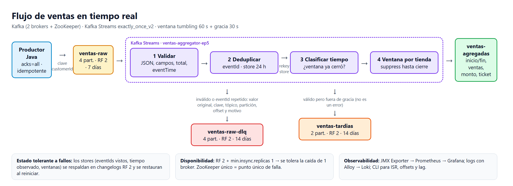

# DSY1107 · Streaming resiliente de ventas (EP5 / EP6)

**Integrantes:** Victor Silva, Darlette Morales y Jonathan Guerra.

Flujo de ventas en tiempo real con Kafka y Kafka Streams. Valida y deduplica cada venta, agrega por tienda según la hora de la venta y sigue funcionando ante la caída de un broker o el reinicio del consumidor.



| Carpeta | Contenido |
| --- | --- |
| [app/app](app/app) | Clúster Kafka (2 brokers + ZooKeeper), productor y Kafka Streams en Java 21, Docker Compose, pruebas, scripts, evidencias, capturas y monitoreo local. **Empieza por su [README](app/app/README.md).** |
| [monitoring/monitoring](monitoring/monitoring) | Prometheus, Grafana, Loki y Alloy con el dashboard *EA3 – Observabilidad integral*, para el despliegue en EC2 de las guías del curso. |

## Inicio rápido

Requiere Docker Desktop con contenedores Linux. En PowerShell:

```powershell
cd app/app
```

```powershell
docker compose -p dsy1107-ep5 --env-file .env.example --profile monitoreo up -d --build
```

```powershell
./scripts/probar-escenarios.ps1
```

Grafana queda en http://127.0.0.1:3300. Los demás escenarios (flujo normal, caída del broker y reinicio del consumidor) están en la [matriz de escenarios](app/app/README.md#9-matriz-de-escenarios).

## Entregables

| Entregable | Dónde |
| --- | --- |
| Manual de ejecución y matriz de escenarios | [app/app/README.md](app/app/README.md) |
| Diagrama actualizado | [app/app/arquitectura_encargo.mmd](app/app/arquitectura_encargo.mmd) |
| Evidencias de ejecución | [app/app/evidencias](app/app/evidencias) |
| Capturas para el informe y la presentación | [app/app/capturas](app/app/capturas/README.md) |
| Pruebas automatizadas | [StreamsAppTest](app/app/src/test/java/cl/duoc/ventas/StreamsAppTest.java) |
| Glosario de conceptos (broker, `acks`, ZooKeeper, ISR, lag, ventanas…) | [app/app/README.md#15](app/app/README.md#15-glosario-de-conceptos) |
