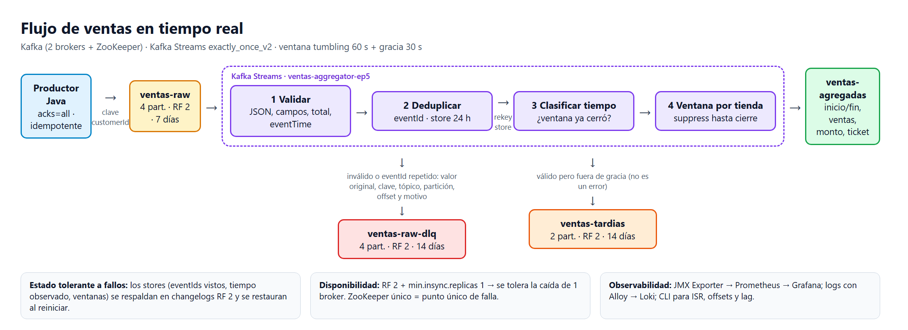
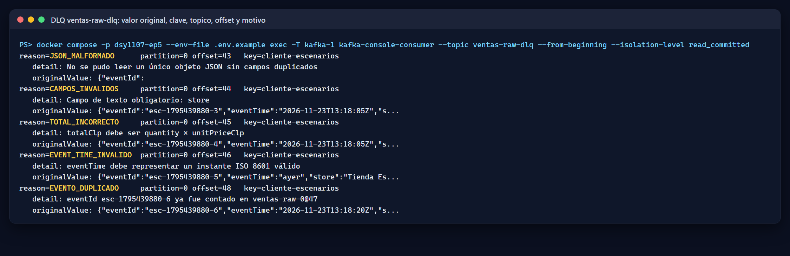
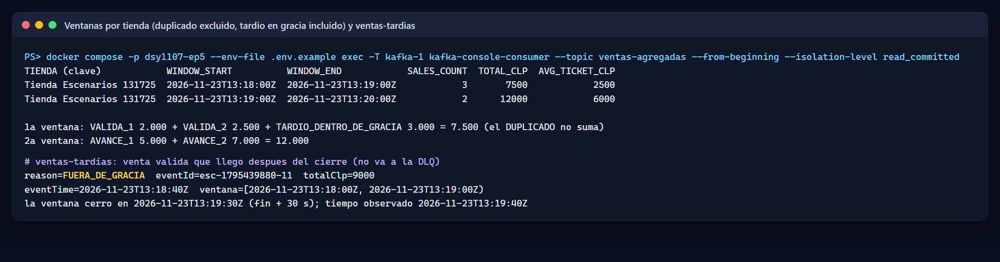
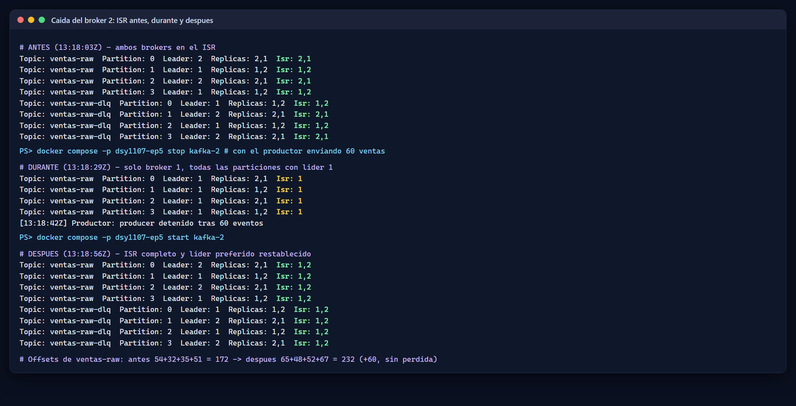
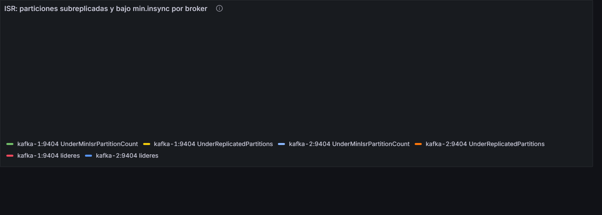
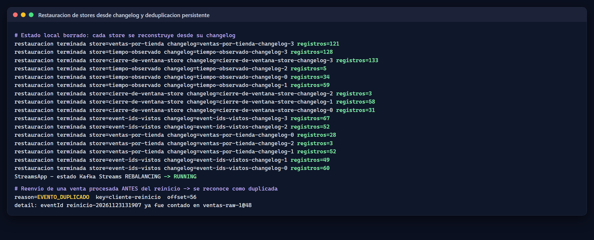
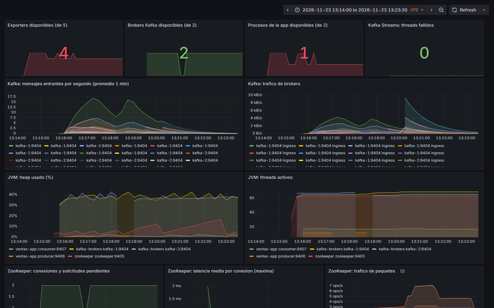

# Streaming resiliente de ventas · DSY1107 (EP5)

**Integrantes:** Victor Silva, Darlette Morales y Jonathan Guerra.

Flujo de ventas en tiempo real con Kafka (dos brokers y ZooKeeper) y Kafka Streams en Java 21. Las ventas inválidas o duplicadas van a una DLQ, las tardías a un tópico propio, y el resultado es un agregado por tienda cada 60 s según la hora de la venta. El sistema sigue funcionando si se cae un broker o se reinicia el consumidor, y todos los escenarios de la EP5 se prueban con scripts reproducibles.



| Resultado verificado (23-11-2026) | Valor | Evidencia |
| --- | --- | --- |
| Pruebas automatizadas | 6 de 6 correctas | [03](evidencias/03-pruebas-streams.txt) |
| Rechazos en la DLQ (escenarios) | 4 inválidos + 1 duplicado, con valor original y motivo | [04](evidencias/04-escenarios-ep5.txt) |
| Ventana con duplicado y tardío | 3 ventas, $7.500 (el duplicado no se cuenta) | [04](evidencias/04-escenarios-ep5.txt) |
| Ventas enviadas durante la caída del broker 2 | 60 de 60 confirmadas | [06](evidencias/06-caida-broker.txt) |
| Lag tras reiniciar Streams sin estado local | de 30 a 0, con 16 stores restaurados | [07](evidencias/07-reinicio-consumidor.txt) |
| Consultas del dashboard de Grafana con datos | 31 de 31 | [02](evidencias/02-monitoreo-grafana.txt) |

## Contenido

1. [Inicio rápido](#1-inicio-rápido)
2. [Arquitectura](#2-arquitectura)
3. [Instalación y configuración](#3-instalación-y-configuración)
4. [Tópicos y configuración del clúster](#4-tópicos-y-configuración-del-clúster)
5. [Validación, logs y DLQ](#5-validación-logs-y-dlq)
6. [Duplicados y semántica de entrega](#6-duplicados-y-semántica-de-entrega)
7. [Tiempo de evento, ventanas y tardíos](#7-tiempo-de-evento-ventanas-y-tardíos)
8. [Pruebas automatizadas](#8-pruebas-automatizadas)
9. [Matriz de escenarios](#9-matriz-de-escenarios)
10. [Observabilidad y operación](#10-observabilidad-y-operación)
11. [Guion de demostración (EP6)](#11-guion-de-demostración-ep6)
12. [Límites conocidos](#12-límites-conocidos)
13. [Recuperación](#13-recuperación)
14. [Estructura del repositorio y secretos](#14-estructura-del-repositorio-y-secretos)
15. [Glosario de conceptos](#15-glosario-de-conceptos): qué es un broker, `acks`, ZooKeeper, ISR, lag, ventana, DLQ y los demás términos de este documento.

## 1. Inicio rápido

> ¿Un término no te resulta familiar (RF, ISR, `acks`, `min.insync.replicas`, lag, ventana, DLQ…)? Está explicado en el [glosario](#15-glosario-de-conceptos), con el valor que usa este proyecto.

Requisito: Docker Desktop con contenedores Linux. Desde esta carpeta (`app/app`), en PowerShell:

```powershell
docker compose -p dsy1107-ep5 --env-file .env.example --profile monitoreo up -d --build
```

```powershell
./scripts/probar-flujo-base.ps1
```

```powershell
./scripts/probar-escenarios.ps1
```

Luego abre Grafana en http://127.0.0.1:3300: se abre en el dashboard **EP5 - Kafka ventas (local)**. Cada script imprime `Resultado: CORRECTO` y guarda su salida en `evidencias/`.

## 2. Arquitectura

Una venta entra a `ventas-raw` con clave `customerId` y pasa por cuatro procesadores de Kafka Streams:

```
Productor ──(clave customerId)──▶ ventas-raw ──▶ Kafka Streams ventas-aggregator-ep5
                                                  1 validar-venta ─────────────▶ ventas-raw-dlq (inválidos)
                                                  2 deduplicar-eventId ────────▶ ventas-raw-dlq (EVENTO_DUPLICADO)
                                                  ── repartición por store ──
                                                  3 clasificar-tiempo ─────────▶ ventas-tardias (fuera de gracia)
                                                  4 ventana 60 s + gracia 30 s ─▶ ventas-agregadas
```

El [diagrama completo](arquitectura_encargo.mmd) ([imagen](capturas/a01-arquitectura.png)) muestra además las particiones, el factor de replicación, los changelogs internos y la observabilidad.

| Pieza | Decisión | Justificación |
| --- | --- | --- |
| Clave en `ventas-raw` | `customerId` | Mantiene en orden las ventas de un mismo cliente. Además, el reenvío de una venta cae en la misma partición, donde vive su `eventId` en el store de deduplicación. Reparte mejor que `store`, que solo tiene 7 valores. |
| Clave de agregación | `store` (repartición explícita `por-tienda`) | La ventana agrupa por tienda. La repartición deja en una misma tarea la política de tardíos y la ventana, así que ambas ven el mismo tiempo observado. |
| Clave en `ventas-agregadas` y `ventas-tardias` | `store` | Un consumidor puede leer en orden todo lo de una tienda. |
| Clave en `ventas-raw-dlq` | La clave original | Se puede reinyectar el registro corregido con la misma clave y en la misma partición. |
| Garantía | `exactly_once_v2` | Offsets, estado y salidas se confirman en una sola transacción. |
| Eventos | Records Java tipados: `Sale` (entrada), `WindowResult` (salida), `Rejection` (DLQ), `LateSale` (tardíos) | Todos los mensajes usan JSON con un esquema fijo. |

Una venta de entrada y su agregado de salida:

```json
{"eventId":"16def4d8-…","eventTime":"2026-11-23T13:15:54.111Z","store":"Paris Marina Arauco","storeFormat":"tienda","city":"Viña del Mar","channel":"presencial","category":"ropa","product":"Zapatillas running","quantity":3,"unitPriceClp":33171,"totalClp":99513,"customerId":"cliente-0069","paymentMethod":"débito"}
{"store":"Paris Marina Arauco","window_start":"2026-11-23T13:15:00Z","window_end":"2026-11-23T13:16:00Z","sales_count":3,"total_clp":139237,"avg_ticket_clp":46412}
```

## 3. Instalación y configuración

**Prerrequisitos**

- Docker Desktop con Docker Compose v2, en modo de contenedores Linux. Maven y Java 21 corren dentro de Docker, así que no hace falta instalarlos.
- Windows PowerShell 5.1 o PowerShell 7 para los scripts de `scripts/`.
- Unos 3 GB de RAM libres para el clúster y la aplicación, y 1 GB más con el perfil `monitoreo`.

**Comandos.** Todos se ejecutan desde la carpeta que contiene `compose.yaml`. El nombre de proyecto (`-p`) aísla tópicos y volúmenes.

```powershell
docker compose -p dsy1107-ep5 --env-file .env.example config --quiet
docker compose -p dsy1107-ep5 --env-file .env.example up -d --build
docker compose -p dsy1107-ep5 --env-file .env.example ps -a
```

- `up --build` compila la imagen y ejecuta `mvn verify`: la imagen solo se construye si pasan las pruebas.
- El servicio `topics` crea los tópicos con `--if-not-exists` y termina con código 0.
- `consumer` es Kafka Streams. El productor está en el perfil `demo` y se lanza aparte.

```powershell
# flujo normal: 80 ventas aleatorias
docker compose -p dsy1107-ep5 --env-file .env.example run --rm --no-deps --use-aliases -e PRODUCER_MAX_EVENTS=80 producer
# ver una venta con su clave y partición, y un agregado confirmado
docker compose -p dsy1107-ep5 --env-file .env.example exec -T kafka-1 kafka-console-consumer --bootstrap-server kafka-1:9092 --topic ventas-raw --from-beginning --max-messages 1 --property print.key=true --property print.partition=true
docker compose -p dsy1107-ep5 --env-file .env.example exec -T kafka-1 kafka-console-consumer --bootstrap-server kafka-1:9092 --topic ventas-agregadas --from-beginning --max-messages 3 --isolation-level read_committed --property print.key=true
```

`--use-aliases` registra el contenedor como `producer` en la red, y así Prometheus puede leer sus métricas.

Para agregar Prometheus, Loki, Alloy y Grafana (sección 10), suma el perfil `monitoreo` al comando `up`:

```powershell
docker compose -p dsy1107-ep5 --env-file .env.example --profile monitoreo up -d --build
```

Para apagarlo: `docker compose -p dsy1107-ep5 --profile monitoreo down`. Con `down -v` también se borran los datos.

### Variables configurables

Todas tienen un valor por defecto en `compose.yaml`, y [.env.example](.env.example) las documenta sin secretos. Se cambian con `-e VAR=valor` en `run` o en un `.env` local, que está excluido de git.

| Variable | Defecto | Efecto |
| --- | --- | --- |
| `GROUP_ID` | `ventas-aggregator-ep5` | `application.id` de Streams: también es el consumer group y el prefijo de los tópicos internos |
| `WINDOW_SECONDS` | `60` | Tamaño de la ventana tumbling |
| `WINDOW_GRACE_SECONDS` | `30` | Período de gracia para eventos fuera de orden |
| `DEDUP_RETENTION_HOURS` | `24` | Tiempo durante el que se recuerda un `eventId` |
| `PRODUCER_MODE` | `aleatorio` | `escenarios` publica la secuencia controlada de la sección 9 |
| `PRODUCER_MAX_EVENTS` | `0` | Cantidad de ventas en modo aleatorio (0 = sin límite) |
| `PRODUCE_INTERVAL` | `1.0` | Segundos entre ventas, con ±30 % de variación |
| `CUSTOMER_POOL` | `200` | Cantidad de clientes distintos |
| `SCENARIO_STORE` | `Tienda Escenarios` | Tienda que usa el modo escenarios |
| `GRAFANA_PORT` | `3300` | Puerto local de Grafana, solo en `127.0.0.1` |
| `PROMETHEUS_PORT` | `9090` | Puerto local de Prometheus, solo en `127.0.0.1` |
| `GRAFANA_ADMIN_PASSWORD` | sin defecto | Contraseña del usuario `admin` del Grafana local. El ejemplo trae un marcador; conviene cambiarlo en un `.env` propio. |

`KAFKA_BOOTSTRAP` y los nombres de los tópicos (`RAW_TOPIC`, `AGG_TOPIC`, `DLQ_TOPIC`, `LATE_TOPIC`) se definen en el bloque `x-app-env` de `compose.yaml`.

## 4. Tópicos y configuración del clúster

| Tópico | Particiones | RF | `min.insync.replicas` | Retención | Motivo |
| --- | ---: | ---: | ---: | --- | --- |
| `ventas-raw` | 4 | 2 | 1 | 7 días | Paralelismo de hasta 4 hilos o instancias de Streams; permite reprocesar una semana. |
| `ventas-agregadas` | 2 | 2 | 1 | 7 días | Bajo volumen: un registro por tienda y por minuto. |
| `ventas-raw-dlq` | 4 | 2 | 1 | 14 días | Más tiempo para inspeccionar, corregir y reinyectar. |
| `ventas-tardias` | 2 | 2 | 1 | 14 días | Mismo criterio que la DLQ: requieren revisión manual. |
| Internos de Streams | 4 | 2 | 1 | Compactados o según la ventana | `replication.factor=2` y `topic.min.insync.replicas=1` se definen en `StreamsApp`. |

Configuración de los brokers en `compose.yaml`:

- `default.replication.factor=2` y `min.insync.replicas=1`;
- `offsets.topic.replication.factor=2`;
- `transaction.state.log.replication.factor=2` y `transaction.state.log.min.isr=1`;
- `auto.create.topics.enable=false`, para que un error de tipeo no cree un tópico con RF 1.

Qué significan RF, ISR, `acks` y `min.insync.replicas`, y cómo se combinan: [Replicación explicada paso a paso](#replicación-explicada-paso-a-paso).

**Por qué RF 2 y no 3:** el factor de replicación no puede superar la cantidad de brokers. Con dos brokers, RF 3 falla al crear el tópico (`InvalidReplicationFactorException`). Con RF 2, cada partición tiene una copia en cada broker.

**Por qué `min.insync.replicas=1`:** con RF 2 y `acks=all`, un valor de 2 rechazaría todas las escrituras (`NotEnoughReplicas`) apenas cayera un broker. Con 1, el sistema sigue escribiendo con un solo broker. El costo: mientras el ISR tiene una sola réplica, cada escritura confirmada existe en un solo disco, y si ese broker se pierde antes de replicar, esos mensajes se pierden. En este clúster se privilegia la disponibilidad. Con tres brokers se usaría RF 3 y `min.insync.replicas=2`.

Para crear e inspeccionar tópicos, configuración, offsets y consumer groups:

```powershell
./scripts/inspeccionar-topicos.ps1 -Proyecto dsy1107-ep5
```

Resultado: [05-topicos-y-grupos.txt](evidencias/05-topicos-y-grupos.txt) · [captura](capturas/t02-topicos-rf-isr.png).

## 5. Validación, logs y DLQ

`SaleValidationProcessor` comprueba lo siguiente:

- que el mensaje sea un único objeto JSON sin claves duplicadas;
- que existan los campos de texto y los enteros obligatorios;
- que `customerId` coincida con la clave Kafka;
- que `quantity`, `unitPriceClp` y `totalClp` sean positivos;
- que `totalClp = quantity × unitPriceClp`;
- que `eventTime` sea un instante ISO 8601 desde 1970.

Un registro inválido no lanza excepción, así que el hilo sigue procesando. El registro va a `ventas-raw-dlq` con esta forma:

```json
{"originalValue":"{\"eventId\":","key":"cliente-escenarios","sourceTopic":"ventas-raw","sourcePartition":0,"sourceOffset":43,"reason":"JSON_MALFORMADO","detail":"No se pudo leer un único objeto JSON sin campos duplicados"}
```

Los motivos posibles son `JSON_MALFORMADO`, `CAMPOS_INVALIDOS`, `TOTAL_INCORRECTO`, `EVENT_TIME_INVALIDO` y `EVENTO_DUPLICADO`. Cada rechazo deja además un log `WARN venta rechazada reason=… topic=… partition=… offset=… key=…`. Con tópico, partición y offset se cruzan el log, la DLQ y el registro original en `ventas-raw`.



**Reinyectar un registro corregido:**

1. Leer `originalValue` desde la DLQ.
2. Corregir el JSON.
3. Publicarlo en `ventas-raw` con la misma clave (`kafka-console-producer --property parse.key=true`).

Se puede usar el mismo `eventId`: los registros rechazados no se guardan como vistos, así que la deduplicación no lo bloquea.

## 6. Duplicados y semántica de entrega

| | `exactly_once_v2` y productor idempotente | Deduplicación por `eventId` |
| --- | --- | --- |
| Evita | Procesar dos veces el mismo offset tras una caída; duplicar un envío por reintento de red | Contar dos registros distintos que representan la misma venta |
| Cómo | Offsets, estado y salidas en una sola transacción; número de secuencia del productor (`enable.idempotence=true`, `acks=all`) | `WindowStore` persistente `event-ids-vistos` (RocksDB + changelog RF 2) |
| No cubre | Que la aplicación de origen envíe dos veces la misma venta: Kafka la guarda como dos offsets distintos y EOS cuenta ambos | Duplicados que llegan después de 24 h o con otro `customerId` |

`DeduplicationProcessor` guarda cada `eventId` junto con la referencia `tópico-partición@offset` del primer registro. Una repetición dentro de `DEDUP_RETENTION_HOURS` (24 h) va a la DLQ como `EVENTO_DUPLICADO`, con el detalle `eventId X ya fue contado en ventas-raw-0@47`, y no llega a la agregación.

- **Retención de 24 h:** cubre reintentos y reenvíos del mismo día con un estado acotado a un `eventId` por venta. Es mucho mayor que la ventana de agregación porque un duplicado puede llegar mucho después.
- **Dónde vive el store:** en la tarea de la partición de `ventas-raw`. Como la clave es `customerId`, un reenvío llega a la misma partición. Un duplicado con otro `customerId` no se detecta, pero esa combinación ya es una venta distinta para el negocio.
- **Persistencia:** el estado sobrevive a los reinicios porque se reconstruye desde su changelog (sección 9).

## 7. Tiempo de evento, ventanas y tardíos

- **Tiempo de evento:** la validación reemplaza el timestamp del registro por `eventTime`. Las ventanas usan la hora en que ocurrió la venta, no la de llegada a Kafka.
- **Ventana:** tumbling de 60 s, alineada al minuto. Muestra la venta por tienda casi en tiempo real sin crear demasiados registros.
- **Gracia:** 30 s. Absorbe los reintentos del productor, el cambio de líder durante la caída de un broker (8 s en la prueba) y diferencias pequeñas entre relojes. Un valor mayor retrasa cada resultado, porque una ventana solo se publica al cerrar en `fin + gracia`.
- **Publicación:** `suppress(untilWindowCloses)` (store `cierre-de-ventana`) emite un solo resultado final por tienda y ventana, con `window_start`, `window_end`, `sales_count`, `total_clp` y `avg_ticket_clp`.
- **Tiempo observado:** avanza con el mayor `eventTime` visto en cada partición de `por-tienda`, no con el reloj de pared. Una ventana cierra cuando llega a esa partición un evento posterior a `fin + gracia`.

**Política para eventos fuera de orden** (`LateEventClassifier`, store `tiempo-observado` con changelog):

| Situación | Condición | Qué pasa | Cómo se detecta |
| --- | --- | --- | --- |
| Dentro de gracia | `fin de su ventana + 30 s > tiempo observado` | Se suma a su ventana original | Log `INFO venta fuera de orden aceptada dentro de gracia` |
| Fuera de gracia | `fin + 30 s <= tiempo observado` | No se suma; va a `ventas-tardias` con la ventana, su cierre y el tiempo observado | Tópico `ventas-tardias`, log `WARN venta tardia fuera de gracia` y métrica `dropped-records` |

Un evento tardío es una venta válida: nunca se clasifica como JSON inválido ni va a la DLQ. Si el negocio lo requiere, se puede reconciliar después desde `ventas-tardias`.



## 8. Pruebas automatizadas

[StreamsAppTest](src/test/java/cl/duoc/ventas/StreamsAppTest.java) usa `TopologyTestDriver`, así que no necesita brokers. Tiene 6 pruebas:

| Prueba | Requisito |
| --- | --- |
| `rejectsMalformedJsonWithOriginalValueAndMetadata` | DLQ con valor original, clave, tópico, partición, offset y motivo |
| `rejectsMissingFieldsIncorrectTotalAndInvalidTime` | Validación de campos, total y `eventTime` |
| `aggregatesValidSalesUsingEventTimeAfterRejectingAnInvalidRecord` | El flujo continúa tras un error; agregado por tienda con `eventTime` |
| `repeatedEventIdIsCountedOnceAndSentToDlqWithReference` | Deduplicación por `eventId` |
| `outOfOrderSaleInsideGraceIsAddedAndAfterGraceGoesToLateTopic` | Escenario temporal: dentro y fuera de la gracia |
| `controlledScenarioSequenceProducesExpectedOutputs` | Secuencia completa del modo escenarios |

Cómo ejecutarlas:

```powershell
docker compose --progress plain --env-file .env.example build consumer
# o solo las pruebas, sin construir la imagen:
docker run --rm -v "${PWD}:/src" -w /src maven:3.9-eclipse-temurin-21 mvn -B -ntp test
```

Resultado: `Tests run: 6, Failures: 0, Errors: 0` ([03-pruebas-streams.txt](evidencias/03-pruebas-streams.txt)).

## 9. Matriz de escenarios

Con el sistema levantado (sección 3), cada script publica sus datos, comprueba el resultado y guarda la evidencia. Si una comprobación falla, termina con código 1. Todos aceptan `-Proyecto <nombre>`.

| Escenario | Comando | Resultado esperado | Evidencia obtenida |
| --- | --- | --- | --- |
| Flujo normal | `./scripts/probar-flujo-base.ps1` | Venta con clave `customerId` en una partición; agregado por tienda al cerrar la ventana; lag 0 | [01](evidencias/01-flujo-base.txt): 160 ventas confirmadas, 7 agregados por tienda, lag 0 |
| JSON malformado, campo ausente, total incorrecto, `eventTime` inválido | `./scripts/probar-escenarios.ps1` | El consumidor sigue activo; 4 registros en la DLQ con el original y su motivo; 4 logs correlacionables | [04](evidencias/04-escenarios-ep5.txt): `JSON_MALFORMADO`, `CAMPOS_INVALIDOS`, `TOTAL_INCORRECTO` y `EVENT_TIME_INVALIDO`, con partición y offset |
| Duplicado de `eventId` | mismo script, caso `DUPLICADO` | Se cuenta una sola vez; la DLQ recibe `EVENTO_DUPLICADO` con referencia al primer registro | [04](evidencias/04-escenarios-ep5.txt): primera ventana con 3 ventas y $7.500; sin el filtro serían 4 ventas y $10.000 |
| Tardío dentro de gracia | caso `TARDIO_DENTRO_DE_GRACIA` (T+30 s con tiempo observado T+70 s) | Se suma a la ventana [T, T+60) | [04](evidencias/04-escenarios-ep5.txt): incluido en las 3 ventas; log `INFO … dentro de gracia` |
| Tardío fuera de gracia | caso `TARDIO_FUERA_DE_GRACIA` (T+40 s con tiempo observado T+100 s) | No se suma; queda en `ventas-tardias`, no en la DLQ | [04](evidencias/04-escenarios-ep5.txt): venta de $9.000 en `ventas-tardias`, `windowClosedAt` = T+90 s |
| Broker 2 detenido mientras se produce | `./scripts/probar-caida-broker.ps1` | El ISR baja a `[1]` y vuelve a `[1,2]`; el productor termina sin errores; lag 0 | [06](evidencias/06-caida-broker.txt): 60 de 60 ventas confirmadas (offsets de 172 a 232) y elección de líder preferido |
| Reinicio del consumidor con estado borrado | `./scripts/probar-reinicio-consumidor.ps1 -BorrarEstado` | Retoma desde los offsets confirmados; reconstruye los stores desde los changelogs; un `eventId` previo se sigue detectando como duplicado | [07](evidencias/07-reinicio-consumidor.txt): lag de 30 a 0, logs `restauracion terminada … registros=N` y `EVENTO_DUPLICADO` tras el reinicio |
| Monitoreo en Grafana | `./scripts/verificar-monitoreo.ps1` (perfil `monitoreo`) | Targets `up` y todas las consultas del dashboard con datos | [02](evidencias/02-monitoreo-grafana.txt): 31 consultas con datos; `UnderReplicatedPartitions` de `kafka-1` llegó a 132 en la caída y volvió a 0 |
| Topología, configuración y grupos | `./scripts/inspeccionar-topicos.ps1` | Particiones, RF, ISR, retención, tópicos internos, offsets y lag | [05](evidencias/05-topicos-y-grupos.txt) |

El script de escenarios usa una tienda con sufijo horario y fija la base T en el minuto siguiente. El tiempo observado es por partición, así que conviene dos precauciones:

- detener el productor aleatorio mientras se ejecuta;
- esperar unos 4 minutos antes de repetirlo en el mismo proyecto, porque la ejecución anterior ya adelantó el tiempo observado de esa partición.

### Detalle de la caída del broker

1. **Antes:** las 4 particiones de `ventas-raw` tienen `Isr: 1,2`, con los líderes repartidos entre ambos brokers.
2. **Durante:** con `kafka-2` detenido, todas las particiones quedan con `Leader: 1` e `Isr: 1`, y `--under-replicated-partitions` las lista todas. El productor (`acks=all`, `min.insync.replicas=1`) sigue confirmando escrituras y solo registra `Node -2 disconnected`. Kafka Streams pierde a su coordinador de grupo (`kafka-2`), encuentra otro en `kafka-1` en segundos y mantiene el lag en 0.
3. **Después:** `kafka-2` vuelve a estar healthy y copia desde el líder lo que le faltaba. El ISR vuelve a `1,2` en menos de 10 s. Los líderes siguen todos en el broker 1 hasta que el script ejecuta `kafka-leader-election --election-type preferred`; Kafka también lo haría solo en unos 5 minutos (`auto.leader.rebalance.enable`).
4. **Límite:** con un solo broker vivo no hay redundancia. Si `kafka-1` hubiera caído en ese momento, las escrituras sin replicar se habrían perdido (sección 4).

| ISR antes, durante y después (CLI) | Particiones subreplicadas (Grafana) |
| --- | --- |
|  |  |

### Detalle del reinicio del consumidor

1. **Durante la parada:** el consumer group conserva sus offsets confirmados y el lag crece. En la evidencia, 30 ventas quedaron como lag 7, 7, 9 y 7 en las particiones 0 a 3.
2. **Al arrancar sin el volumen `streams-state`:** cada store se reconstruye leyendo su changelog desde el offset 0 (`restauracion iniciada … pendientes=N`) antes de pasar a `RUNNING`.
3. **Después:** se procesan las ventas pendientes y el lag vuelve a 0.

No hay pérdida silenciosa: lo que no se confirmó se reprocesa, y `exactly_once_v2` descarta sus salidas parciales. Con el volumen intacto, la restauración solo lee desde el último checkpoint y es casi inmediata.



## 10. Observabilidad y operación

| Señal | Comando o fuente | Acción operativa |
| --- | --- | --- |
| ISR y particiones subreplicadas | `kafka-topics --describe --under-replicated-partitions` | Si no está vacío, revisar el broker que falta y su disco. Mientras tanto no hay redundancia. |
| Consumer lag | `kafka-consumer-groups --describe --group ventas-aggregator-ep5` | Si crece de forma sostenida, revisar errores y throughput. Escalar con más instancias o `num.stream.threads` (hasta 4, por las particiones); si no alcanza, aumentar particiones. |
| Asignación de particiones | Columnas `CONSUMER-ID` y `HOST` del mismo comando | Detectar instancias caídas o rebalanceos continuos. |
| DLQ y tardíos | `kafka-get-offsets` sobre `ventas-raw-dlq` y `ventas-tardias` | Si suben, revisar al productor de origen, sus datos o su reloj. Ajustar la gracia si los tardíos son frecuentes y legítimos. |
| Estado de Streams | Logs `estado Kafka Streams A -> B` y `restauracion …` | Si se queda en `REBALANCING` o `ERROR`, revisar los brokers y el estado local. |

### Monitoreo local con Grafana

Cada JVM publica sus métricas en HTTP `/metrics` mediante el agente JMX Exporter 1.0.1 (Maven Central, regla `.*` en [monitoreo/jmx/config.yml](monitoreo/jmx/config.yml)).

- **Puertos:** 9404 en los brokers, 9405 en ZooKeeper, 9406 en el productor y 9407 en Streams.
- **Cómo llega el agente:** viene dentro de la imagen de la app, y el servicio `jmx-agent` lo copia a un volumen que montan ZooKeeper y los brokers.
- **Por qué `KAFKA_OPTS` solo en el servidor:** se exporta únicamente para el proceso del servidor. Así el healthcheck y los `docker compose exec kafka-1 kafka-…` no intentan abrir un segundo exporter en el mismo puerto.

| Componente | Acceso | Contenido |
| --- | --- | --- |
| Grafana | http://127.0.0.1:3300 (anónimo con rol Editor, que permite usar Explore) | Dashboard de inicio **EP5 - Kafka ventas (local)**, en la carpeta *Ventas Lab* |
| Prometheus | http://127.0.0.1:9090/targets | Jobs `kafka-brokers`, `zookeeper` y `ventas-app` ([monitoreo/prometheus.yml](monitoreo/prometheus.yml)) |
| Loki + Alloy | Desde Grafana (fuente *Loki*) | Logs de los contenedores de este proyecto Compose ([monitoreo/alloy.alloy](monitoreo/alloy.alloy)) |

El [dashboard local](monitoreo/grafana/dashboards/ep5-local.json) es el *EA3 – Observabilidad integral* del curso, con las IP de EC2 reemplazadas por los nombres de servicio Docker. Agrega una fila **EP5** con estos paneles:

- mensajes por segundo en `ventas-raw`, `ventas-agregadas`, `ventas-raw-dlq` y `ventas-tardias`;
- lag de Streams por partición;
- particiones subreplicadas y bajo `min.insync` por broker, con la cantidad de líderes;
- registros procesados y descartados por Streams (`dropped-records`);
- logs de rechazos y duplicados;
- logs de eventos tardíos, fuera de orden y restauraciones.



La verificación ([02-monitoreo-grafana.txt](evidencias/02-monitoreo-grafana.txt), generada con `./scripts/verificar-monitoreo.ps1`) dio estos resultados:

- todos los targets quedaron `up`, salvo el productor cuando no está corriendo;
- las 31 consultas del dashboard devolvieron datos después de los scripts de escenarios y de caída del broker.

Los indicadores *Exporters disponibles (de 5)* y *Procesos de la app (de 2)* cuentan también al productor, que solo existe mientras corre `docker compose run`. Fuera de esas ejecuciones marcan 4 y 1, en rojo.

La versión EC2 del curso se despliega aparte con la carpeta `monitoring/`, siguiendo las guías *Despliegue Prometheus/Grafana* y *Scrapeo Kafka/ZooKeeper/app*, y usa el mismo agente con `JAVA_TOOL_OPTIONS`.

**Métricas de negocio:** no hay contadores Prometheus propios para rechazos por motivo ni para tardíos. Para mostrarlos se usan:

- la tasa de mensajes de `ventas-raw-dlq` y `ventas-tardias`, en el panel de la fila EP5;
- los logs `WARN` en Loki, por ejemplo `{service="consumer"} |= "venta rechazada"`;
- la métrica JMX de Streams `kafka_streams_stream_task_metrics_dropped_records`.

## 11. Guion de demostración (EP6)

Con el sistema y el perfil `monitoreo` ya levantados, Grafana abierto y el productor aleatorio detenido. Cada bloque usa un script que imprime `Resultado: CORRECTO`; si la demo en vivo falla, las capturas de [capturas/](capturas/README.md) muestran la misma salida.

| Tiempo | Parte | Qué ejecutar o mostrar | Qué explicar |
| --- | --- | --- | --- |
| 0:00–1:00 | Arquitectura | Imagen del flujo (arriba) y [diagrama](arquitectura_encargo.mmd) | Dos brokers y un ZooKeeper; por qué RF 2; DLQ y tardíos |
| 1:00–2:30 | Flujo normal | `./scripts/probar-flujo-base.ps1` | Clave `customerId` y partición; consumer group; agregado al cerrar la ventana |
| 2:30–4:30 | Fallo de datos | `./scripts/probar-escenarios.ps1`; panel de logs de la DLQ | Motivo y valor original en la DLQ; el duplicado no suma; EOS frente a deduplicación |
| 4:30–6:30 | Tiempo y recuperación | Casos tardíos del mismo script; `./scripts/probar-caida-broker.ps1`; panel ISR | Gracia; tardío frente a inválido; ISR antes, durante y después; `min.insync.replicas=1` |
| 6:30–8:30 | Operación | `./scripts/inspeccionar-topicos.ps1`; paneles de lag y mensajes por tópico | Offsets, lag y asignación de particiones, con la acción operativa de cada señal |
| 8:30–10:00 | Cierre | Sección 12 | Riesgo principal (ZooKeeper único) y mejora priorizada (3 brokers, RF 3, KRaft) |

## 12. Límites conocidos

- **ZooKeeper tiene un solo nodo y es un punto único de falla.** Si cae, los brokers siguen atendiendo lecturas y escrituras con los líderes actuales. Pero no se pueden elegir líderes nuevos, crear tópicos ni actualizar el ISR, y una caída de broker en ese momento deja sus particiones sin líder. Se necesitarían 3 nodos de ZooKeeper o migrar a KRaft.
- **Un broker de margen:** con dos brokers y RF 2 se tolera la caída de **un** broker. Con `min.insync.replicas=1`, durante la degradación no hay redundancia (sección 4).
- **Mismo host:** en esta instalación local todos los contenedores comparten un equipo, así que la prueba simula la caída de un proceso, no la de una máquina. En la versión EC2 de la guía, cada broker tiene su propia instancia.
- **Tiempo observado por partición** de `por-tienda`: una tienda con el reloj adelantado puede cerrar ventanas de otras tiendas en la misma partición y volverlas tardías.
- **Deduplicación acotada:** cubre 24 h y requiere que el duplicado conserve la misma clave `customerId`.
- **Buffer de `suppress`:** es ilimitado y guarda en memoria las ventanas abiertas, una por tienda activa en los últimos 90 s. Con este volumen es poco.
- **Sin réplicas en espera** (`num.standby.replicas=0`): si se reemplaza una instancia sin su volumen, hay que restaurar desde el changelog. En la evidencia tomó unos segundos.
- **Origen de las evidencias:** todas (01 a 07) se generaron el 23-11-2026 con la versión final, sobre un stack recreado desde cero (`down -v`). Los scripts se ejecutaron en este orden: flujo base, escenarios, caída de broker, reinicio, monitoreo y tópicos.

## 13. Recuperación

| Falla | Pasos |
| --- | --- |
| Broker caído | `docker compose -p <p> --env-file .env.example start kafka-2`. Esperar `healthy` y confirmar que `kafka-topics --describe --under-replicated-partitions` está vacío. Luego, `kafka-leader-election --bootstrap-server kafka-1:9092 --election-type preferred --all-topic-partitions`. |
| Kafka Streams caído o reiniciado | `docker compose -p <p> --env-file .env.example up -d consumer` y esperar el log `-> RUNNING`. Verificar lag 0 con `kafka-consumer-groups`. |
| Estado local corrupto | `docker compose -p <p> rm -sf consumer` y `docker volume rm <p>_streams-state`, luego `up -d consumer`. Los stores se reconstruyen desde los changelogs. |
| ZooKeeper caído | `docker compose -p <p> --env-file .env.example start zookeeper`. Los brokers se reconectan solos. Revisar el ISR. |
| Broker sale con `NodeExists` al recrear ZooKeeper | ZooKeeper aún conserva el registro efímero de la sesión anterior. Los brokers tienen `restart: on-failure` y se reintentan solos cuando la sesión expira (unos 18 s). Si no, ejecutar `up -d` de nuevo. |
| Registros en la DLQ | Revisar `reason` y `detail`, corregir el JSON y volver a publicarlo en `ventas-raw` con la misma clave (sección 5). |
| Reprocesar desde cero (cambio de topología) | Detener `consumer` y ejecutar dentro de `kafka-1`: `kafka-streams-application-reset --application-id ventas-aggregator-ep5 --input-topics ventas-raw --bootstrap-server kafka-1:9092`. Luego borrar el volumen `streams-state` y levantarlo otra vez. Otra opción es usar un `GROUP_ID` nuevo. |

## 14. Estructura del repositorio y secretos

```
app/app/
├── compose.yaml                 # ZooKeeper, 2 brokers, tópicos, app y perfil monitoreo
├── .env.example                 # variables sin secretos
├── Dockerfile · pom.xml         # build Java 21 + pruebas + agente JMX
├── arquitectura_encargo.mmd     # diagrama del encargo
├── src/main/java/cl/duoc/ventas
│   ├── ProducerApp, Scenarios   # productor aleatorio y escenarios controlados
│   ├── StreamsApp               # topología y configuración de Streams
│   ├── SaleValidationProcessor  # 1 validación → DLQ
│   ├── DeduplicationProcessor   # 2 deduplicación por eventId
│   ├── LateEventClassifier      # 3 política de tardíos
│   └── Sale, WindowResult, …    # DTO y serialización JSON
├── src/test/…/StreamsAppTest    # 6 pruebas con TopologyTestDriver
├── scripts/                     # escenarios reproducibles (PowerShell 5.1 y 7)
├── evidencias/                  # salidas 01 a 07 de los scripts
├── capturas/                    # 23 imágenes para el informe y la presentación
└── monitoreo/                   # Prometheus, Alloy, Grafana y JMX locales
```

**Secretos:**

- El repositorio no tiene credenciales. `.env.example` solo trae parámetros funcionales, y `.gitignore` excluye `.env` y `*.env` (excepto los ejemplos).
- El clúster local usa `PLAINTEXT` sin autenticación y no publica puertos de Kafka al host: todo el acceso es por `docker compose exec`.
- Grafana y Prometheus solo escuchan en `127.0.0.1`.
- `GRAFANA_ADMIN_PASSWORD` en `.env.example` es un marcador local. Para cualquier otro uso, define una contraseña propia en un `.env` que no se versiona. En la versión EC2, la contraseña de Grafana va en `monitoring.env`, que tampoco se versiona.

## 15. Glosario de conceptos

Explicación de cada término que aparece en este documento, con el valor que usa este proyecto. Los cuatro conceptos de replicación, que son los que más se preguntan en la defensa, se explican primero en detalle; después vienen las tablas por tema.

### Replicación explicada paso a paso

**RF (factor de replicación) = cuántas copias hay de cada partición.**
Con RF 2, cada partición se guarda en 2 brokers distintos. En este proyecto hay 2 brokers, así que cada partición tiene una copia en `kafka-1` y otra en `kafka-2`:

| Partición de `ventas-raw` | Copia líder | Copia seguidora |
| --- | --- | --- |
| 0 | broker 2 | broker 1 |
| 1 | broker 1 | broker 2 |
| 2 | broker 2 | broker 1 |
| 3 | broker 1 | broker 2 |

- **Líder:** la copia que atiende las lecturas y escrituras.
- **Seguidora:** la copia que se mantiene al día copiando del líder.
- **Para qué sirve:** si cae un broker, la otra copia asume como líder y no se pierden datos.
- **Por qué 2 y no 3:** cada copia debe estar en un broker distinto, así que el RF no puede superar la cantidad de brokers. Con 2 brokers, Kafka rechaza RF 3.

**ISR (in-sync replicas) = las copias que están al día con el líder.**
En normalidad, el ISR de cada partición es `1,2`: ambas copias tienen los mismos mensajes. Si un broker se cae o se atrasa, sale del ISR. En la prueba, al detener `kafka-2` el ISR quedó en `1`, y cuando el broker volvió y copió lo que le faltaba, regresó a `1,2` en 8 s.

**`acks` = cuántas copias deben confirmar un mensaje antes de darlo por escrito.** Lo configura el productor:

| Valor | El productor espera a… | Riesgo |
| --- | --- | --- |
| `acks=0` | Nadie: envía y sigue | Puede perder mensajes sin enterarse |
| `acks=1` | Solo al líder | Si el líder cae antes de copiar, el mensaje se pierde |
| `acks=all` (este proyecto) | Todas las copias del ISR | El más seguro: el mensaje está en todas las copias sincronizadas |

**`min.insync.replicas` = el mínimo de copias que debe tener el ISR para aceptar una escritura con `acks=all`.**
Funciona como un piso de seguridad que fija el broker. Si el ISR tiene menos copias que ese mínimo, el broker rechaza la escritura con el error `NotEnoughReplicas`.

| Configuración | Con ambos brokers vivos | Con un broker caído (ISR = 1) |
| --- | --- | --- |
| RF 2 y `min.insync.replicas=2` | Escribe en 2 copias | **Rechaza las escrituras**: el sistema deja de recibir ventas |
| RF 2 y `min.insync.replicas=1` (este proyecto) | Escribe en 2 copias | **Sigue escribiendo** en la única copia viva |

Se eligió 1 para priorizar la **disponibilidad**: el sistema sigue recibiendo ventas aunque caiga un broker, como mostró la prueba (60 de 60 ventas confirmadas). El costo es la **durabilidad**: mientras dura la caída, cada venta existe en un solo disco, y si ese broker también fallara se perderían las ventas aún no replicadas.

**Cómo se combinan los cuatro:** el productor envía con `acks=all`. El líder espera a todas las copias del ISR, y el ISR debe tener al menos `min.insync.replicas` copias. Con RF 2 y `min.insync.replicas=1`, se tolera la caída de un broker sin dejar de escribir. La configuración recomendada con 3 brokers es RF 3 y `min.insync.replicas=2`: tolera la caída de un broker **y** mantiene siempre al menos 2 copias de cada venta.

**En una frase, para la defensa:**

- **RF 2:** cada partición tiene dos copias, una por broker.
- **ISR:** son las copias que están al día.
- **`acks=all`:** espera a todas las copias del ISR.
- **`min.insync.replicas=1`:** permite seguir escribiendo con una sola copia viva, a cambio de no tener respaldo mientras dure la caída.

### Kafka y el clúster

| Concepto | Qué es | En este proyecto |
| --- | --- | --- |
| **Kafka** | Plataforma que guarda mensajes en registros ordenados y los entrega a quien los lea. Los mensajes no se borran al leerlos: quedan disponibles durante el tiempo de retención. | Transporta las ventas, los agregados, la DLQ y los tardíos. |
| **Broker** | Cada servidor de Kafka. Guarda las particiones y atiende a productores y consumidores. Varios brokers forman un **clúster**. | Dos brokers: `kafka-1` y `kafka-2`. |
| **ZooKeeper** | Servicio de coordinación que usa Kafka para saber qué brokers están vivos, quién lidera cada partición, qué réplicas están sincronizadas y qué tópicos existen. No guarda las ventas. | Un solo nodo: es el **punto único de falla**. Si cae, los brokers siguen atendiendo, pero no se pueden elegir líderes nuevos ni crear tópicos. |
| **KRaft** | Modo nuevo de Kafka que reemplaza a ZooKeeper: los propios brokers se coordinan entre sí. | Es la mejora propuesta para eliminar el punto único de falla. |
| **Tópico** | Canal con nombre donde se publican mensajes del mismo tipo. | `ventas-raw`, `ventas-agregadas`, `ventas-raw-dlq` y `ventas-tardias`. |
| **Partición** | Cada tópico se divide en particiones, y cada una es una fila ordenada de mensajes. El orden solo se garantiza dentro de una partición. Más particiones permiten más consumidores en paralelo. | `ventas-raw` tiene 4 particiones. |
| **Offset** | Número de posición de un mensaje dentro de su partición (0, 1, 2…). El consumidor recuerda hasta qué offset leyó. | La DLQ guarda el offset del mensaje original para poder ubicarlo. |
| **Clave (key)** | Valor que acompaña al mensaje. Kafka envía siempre la misma clave a la misma partición, y así se mantiene el orden por clave. | `customerId` en `ventas-raw`; `store` en los agregados. |
| **Retención** | Tiempo que Kafka conserva los mensajes antes de borrarlos. | 7 días en los tópicos de negocio; 14 días en la DLQ y en los tardíos. |
| **Tópico compactado** | Tópico que, en lugar de borrar por tiempo, conserva solo el último valor de cada clave. | Los changelogs de Kafka Streams. |

### Replicación y disponibilidad

| Concepto | Qué es | En este proyecto |
| --- | --- | --- |
| **Réplica** | Copia de una partición guardada en otro broker, para no perder datos si uno se cae. | Cada partición tiene una copia en cada broker. |
| **RF (factor de replicación)** | Cantidad de copias de cada partición. No puede ser mayor que la cantidad de brokers. | RF 2. RF 3 es imposible con dos brokers. |
| **Líder** | La réplica que atiende las lecturas y escrituras de una partición. Las demás réplicas, las seguidoras, copian desde ella. | Al caer `kafka-2`, el broker 1 pasa a liderar todas las particiones. |
| **Líder preferido** | El broker que debería liderar una partición en condiciones normales. Una **elección de líder preferido** reparte otra vez el liderazgo después de una caída. | Se ejecuta con `kafka-leader-election` al final de la prueba de caída. |
| **ISR (in-sync replicas)** | Lista de réplicas que están al día con el líder. Si un broker se cae o se atrasa, sale del ISR, y vuelve a entrar cuando se pone al día. | `Isr: 1,2` en normalidad; `Isr: 1` con `kafka-2` caído. |
| **Partición subreplicada** | Partición con menos réplicas en el ISR que su RF. Indica que se perdió redundancia. | 132 particiones subreplicadas durante la caída de `kafka-2`. |
| **`acks`** | Configuración del productor que define cuántas réplicas deben confirmar un mensaje antes de darlo por escrito: `acks=0` no espera confirmación; `acks=1` espera solo al líder; `acks=all` espera a todas las réplicas del ISR. | `acks=all`: el mensaje se confirma solo cuando lo tienen todas las réplicas sincronizadas. |
| **`min.insync.replicas`** | Mínimo de réplicas en el ISR para aceptar una escritura con `acks=all`. Si hay menos, el broker la rechaza (`NotEnoughReplicas`). | 1: el sistema sigue escribiendo con un solo broker vivo, a costa de no tener copia mientras dure la caída. |

### Productor, consumidor y garantías de entrega

| Concepto | Qué es | En este proyecto |
| --- | --- | --- |
| **Productor** | Programa que publica mensajes en un tópico. | `ProducerApp`, en modo aleatorio o de escenarios. |
| **Consumidor** | Programa que lee mensajes de un tópico. | Kafka Streams (servicio `consumer`). |
| **Consumer group** | Conjunto de consumidores que se reparten las particiones de un tópico: cada partición la lee un solo miembro. El grupo guarda sus offsets en Kafka. | `ventas-aggregator-ep5`. |
| **Lag** | Diferencia entre el último offset escrito y el último leído por el grupo: cuántos mensajes faltan por procesar. Lag 0 significa que el consumidor va al día. | Subió a 30 con el consumidor detenido y volvió a 0 al reiniciarlo. |
| **Rebalanceo** | Redistribución de particiones entre los miembros de un grupo cuando uno entra o sale. | Ocurre al reiniciar Streams (`REBALANCING -> RUNNING`). |
| **Productor idempotente** | El productor numera sus envíos y el broker descarta los repetidos por reintentos de red, así que un reintento no duplica el mensaje. | `enable.idempotence=true`. |
| **Exactly-once (`exactly_once_v2`)** | Garantía de Kafka Streams: leer un mensaje, actualizar el estado y escribir los resultados ocurre en una sola **transacción**. Si algo falla a la mitad, todo se deshace y se reintenta sin duplicar resultados. | Activado en `StreamsApp`. |
| **Transacción** | Grupo de escrituras que se confirma completo o no se confirma. Los lectores con `read_committed` solo ven lo confirmado. | Los comandos de lectura usan `--isolation-level read_committed`. |
| **Duplicado de negocio** | La misma venta enviada dos veces por la aplicación de origen. Para Kafka son dos mensajes distintos, así que exactly-once no lo detecta. | Se detecta por `eventId` y va a la DLQ como `EVENTO_DUPLICADO`. |

### Kafka Streams y procesamiento

| Concepto | Qué es | En este proyecto |
| --- | --- | --- |
| **Kafka Streams** | Biblioteca Java para procesar flujos de Kafka: lee de tópicos, transforma o agrega, y escribe en otros tópicos. | `StreamsApp`, con cuatro pasos. |
| **Topología** | Grafo de pasos por los que pasa cada mensaje dentro de Streams. | Validar → deduplicar → reparticionar → clasificar tiempo → ventana. |
| **Procesador** | Cada paso de la topología. | `SaleValidationProcessor`, `DeduplicationProcessor` y `LateEventClassifier`. |
| **Tarea (task)** | Unidad de trabajo de Streams: cada tarea procesa una partición. | 4 tareas por cada tópico de entrada. |
| **Repartición** | Volver a escribir los mensajes con otra clave en un tópico interno, para que queden agrupados por esa clave. | Tópico interno `por-tienda`, con clave `store`. |
| **State store** | Almacén local donde Streams guarda estado entre mensajes, como conteos o `eventId` ya vistos. | `event-ids-vistos`, `tiempo-observado`, `ventas-por-tienda` y `cierre-de-ventana`. |
| **RocksDB** | Base de datos en disco que usa Streams para sus state stores. | Vive en el volumen `streams-state`. |
| **Changelog** | Tópico interno compactado donde Streams copia cada cambio de un state store. Si se pierde el disco local, el store se **restaura** leyendo su changelog. | En la prueba de reinicio se restauraron 16 stores después de borrar el volumen. |
| **Serde** | Serializador y deserializador: convierte objetos Java a bytes y de vuelta. | `JsonSerde`, que usa JSON. |
| **DTO / record** | Clase simple que solo transporta datos, con campos tipados. | `Sale`, `WindowResult`, `Rejection` y `LateSale`. |

### Tiempo y ventanas

| Concepto | Qué es | En este proyecto |
| --- | --- | --- |
| **Tiempo de evento** | Hora en que ocurrió el hecho, escrita dentro del mensaje. | El campo `eventTime` de la venta. |
| **Tiempo de llegada** | Hora en que el mensaje llegó a Kafka. Puede ser posterior al tiempo de evento por reintentos, redes lentas o caídas. | No se usa para agregar. |
| **Ventana tumbling** | Intervalos de tiempo fijos, contiguos y sin solaparse (13:00–13:01, 13:01–13:02…). Cada evento cae en una sola ventana. | Ventanas de 60 s por tienda. |
| **Período de gracia** | Tiempo extra que una ventana espera, después de su fin, para aceptar eventos atrasados. | 30 s: una ventana que termina a las 13:19:00 cierra a las 13:19:30. |
| **Tiempo observado (stream time)** | Mayor tiempo de evento visto hasta ahora en una partición. Las ventanas cierran según este tiempo, no según el reloj del computador. | Se guarda en el store `tiempo-observado`. |
| **Evento fuera de orden** | Evento que llega después de otro más reciente. Si llega antes del cierre de su ventana, se suma igual. | Caso `TARDIO_DENTRO_DE_GRACIA`. |
| **Evento tardío** | Evento que llega cuando su ventana ya cerró. Es una venta válida, no un error. | Va al tópico `ventas-tardias`, no a la DLQ. |
| **`suppress`** | Operación que retiene los resultados intermedios de una ventana y publica un solo resultado final al cerrarla. | Store `cierre-de-ventana`. |

### Manejo de errores

| Concepto | Qué es | En este proyecto |
| --- | --- | --- |
| **DLQ (dead letter queue)** | Tópico donde se guardan los mensajes que no se pudieron procesar, con su motivo, para revisarlos y corregirlos sin detener el flujo. | `ventas-raw-dlq`, con valor original, clave, tópico, partición, offset y motivo. |
| **Reinyectar** | Volver a publicar en el tópico de entrada un mensaje corregido desde la DLQ. | Se publica en `ventas-raw` con la misma clave. |

### Observabilidad

| Concepto | Qué es | En este proyecto |
| --- | --- | --- |
| **Métrica** | Valor numérico medido en el tiempo, como mensajes por segundo, lag o memoria usada. | Cada JVM expone las suyas en `/metrics`. |
| **JMX** | Mecanismo estándar de Java para exponer métricas internas de un programa. | Kafka, ZooKeeper y la app publican sus métricas por JMX. |
| **JMX Exporter** | Agente que traduce las métricas JMX a un formato que Prometheus lee por HTTP. | Puertos 9404 (brokers), 9405 (ZooKeeper), 9406 (productor) y 9407 (Streams). |
| **Prometheus** | Base de datos de métricas que consulta (*scrapea*) periódicamente cada endpoint `/metrics`. Cada endpoint es un **target**. | 6 targets, consultados cada 15 s. |
| **Grafana** | Herramienta de paneles que grafica las métricas de Prometheus y los logs de Loki. | Dashboard *EP5 - Kafka ventas (local)* en http://127.0.0.1:3300. |
| **Loki** | Base de datos de logs, consultable desde Grafana. | Guarda los logs de los contenedores. |
| **Alloy** | Agente que recoge los logs de los contenedores Docker y los envía a Loki. | Solo envía los logs de este proyecto Compose. |
| **Log** | Línea de texto que un programa escribe para registrar lo que hace. | `WARN venta rechazada …`, `restauracion terminada …`. |

### Herramientas

| Concepto | Qué es | En este proyecto |
| --- | --- | --- |
| **Docker** | Ejecuta programas en **contenedores**: entornos aislados con todo lo que el programa necesita. | Cada broker, ZooKeeper, la app y el monitoreo corren en su propio contenedor. |
| **Docker Compose** | Define y levanta varios contenedores juntos desde un archivo (`compose.yaml`). | Un comando levanta todo el sistema. |
| **Volumen** | Carpeta persistente de Docker que sobrevive cuando se recrea un contenedor. | Datos de Kafka, de ZooKeeper y estado de Streams (`streams-state`). |
| **Perfil de Compose** | Grupo de servicios que solo se levanta si se pide de forma explícita. | `demo` (productor) y `monitoreo` (Prometheus, Grafana, Loki y Alloy). |
| **Healthcheck** | Comando que Docker ejecuta periódicamente para saber si un servicio funciona. | Los brokers aparecen como `healthy` cuando responden. |
| **Maven** | Herramienta que compila el código Java, descarga dependencias y ejecuta las pruebas. | `mvn verify` corre dentro del build de la imagen. |
| **TopologyTestDriver** | Utilidad de Kafka Streams para probar la topología sin brokers reales. | La usan las 6 pruebas automatizadas. |
